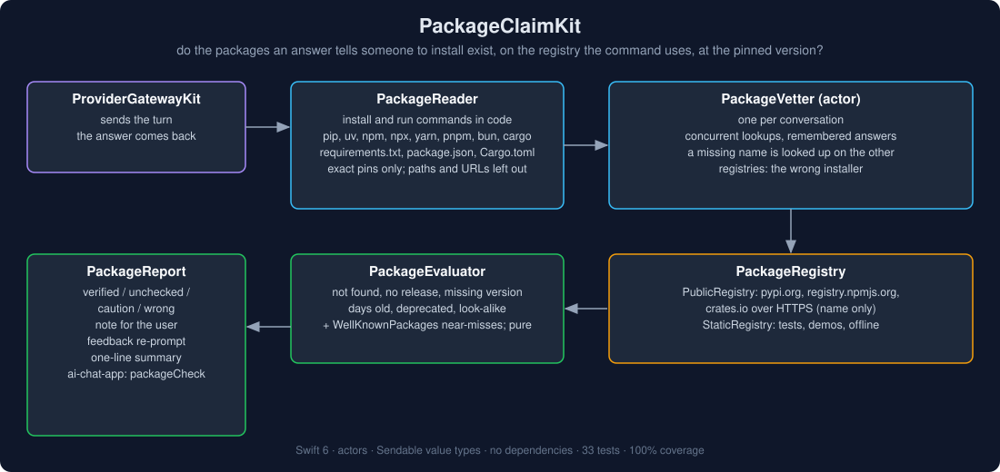
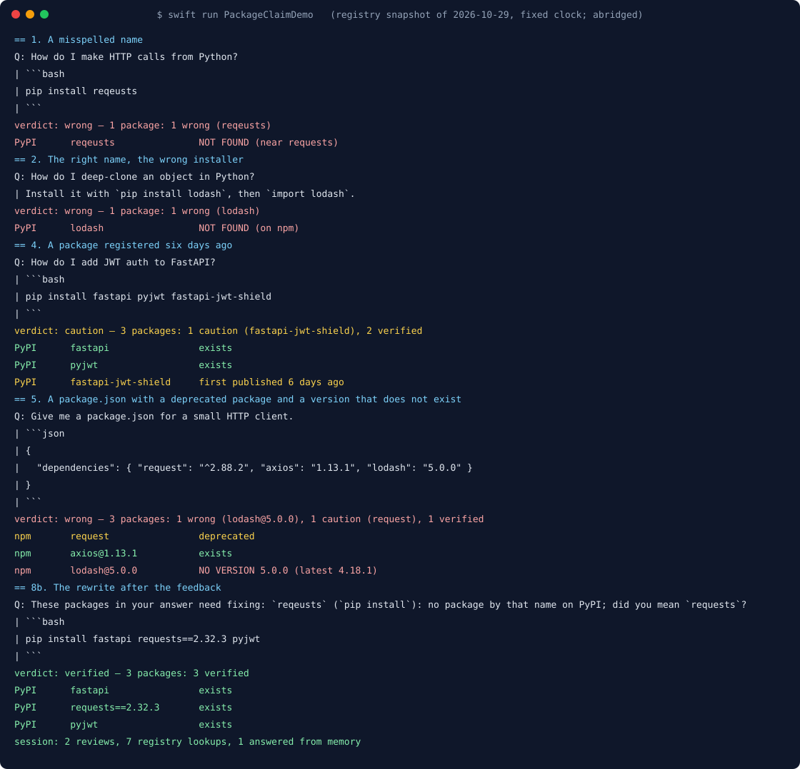
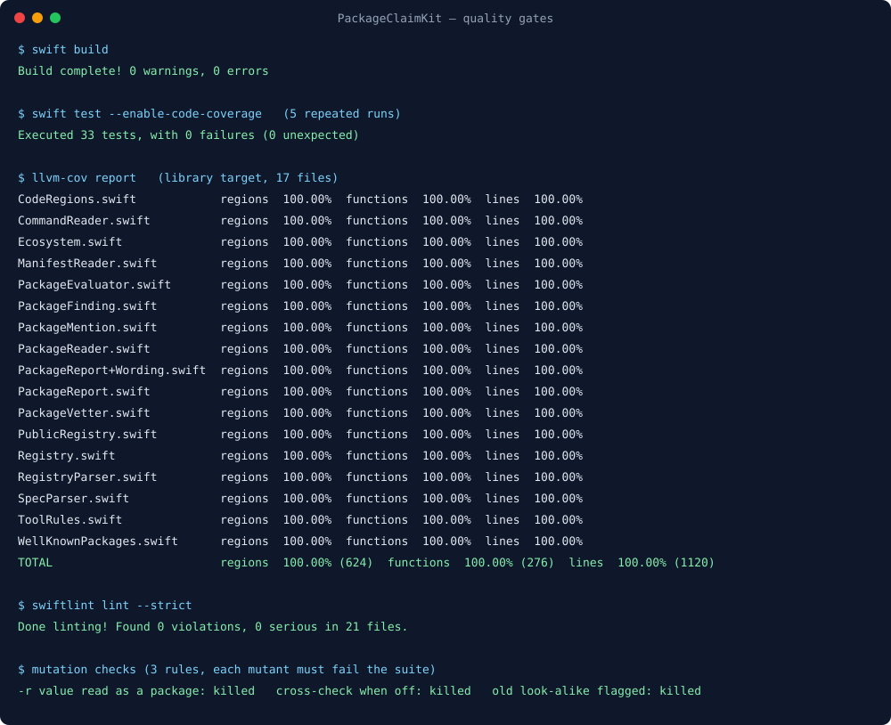

# PackageClaimKit



A user asks how to make HTTP calls from Python and the answer says `pip install reqeusts`. Another asks
for JWT auth in FastAPI and gets `pip install fastapi-jwt-shield`, a name nobody had registered until
last week. A third gets `pip install lodash` (an npm package), and a fourth a `package.json` pinning
`lodash` to `5.0.0`, a version that has never been published.

Models invent package names, and they invent the same ones again and again. Spracklen et al. (USENIX
Security 2025) found at least 5.2% of the packages commercial models suggested did not exist (21.7% for
open models), and 43% of the invented names came back in all ten reruns of the same prompt. A 2026
replication (Churilov, a preprint) on five newer frontier models measured 4.6% to 6.1%, and found 127 names that all five
invented identically. A name that is invented that predictably can be registered by an attacker, so the
next person who pastes the command installs the attacker's code. The attack is called *slopsquatting*.

PackageClaimKit reads the install commands and manifests in an answer, asks the registry about each
package, and says which ones do not exist, which come from the wrong ecosystem, which pin a version that
was never released, and which were registered days ago or look like a well-known name.

## Why

Nothing else in this ecosystem looks at the code an answer tells someone to run. `LinkEgressKit` checks
links, `HiddenTextKit` and `ContentBoundaryKit` check what goes into the model, `NumberBindingKit` checks
figures against evidence. A command in a code block is the part of an answer people copy without reading.

The hard part is reading commands the way a shell would: `pip install -r requirements.txt` installs no
package called `requirements.txt`, `npx -p cowsay cowsay hello` runs one package, `npm create vite@latest`
runs `create-vite`, and `pip install --index-url https://pypi.corp/simple tools` says nothing about PyPI.
A checker that gets those wrong reports packages that were never named, and gets turned off.

## What it gives you

- **`PackageReader`**: `mentions(in:)` returns every `PackageMention` in an answer's code (fenced blocks
  and inline spans; prose is never read):
  - commands: `pip`/`pip3`/`python -m pip install`, `pipx`, `uv add`, `uv pip install`, `uvx`,
    `poetry add`, `pdm add`, `pipenv install`; `npm install` (and its aliases), `npm create`/`init`,
    `npx`, `npm exec`, `yarn add`/`create`/`dlx`, `pnpm add`/`dlx`/`create`, `bun add`, `bunx`;
    `cargo add`, `cargo install`. Prompts (`$`, `%`), `sudo`, `RUN`, `!pip`/`%pip`, environment
    assignments, `&&`/`;`/`|` chains, line continuations and comments are handled.
  - manifests: `requirements.txt`, the dependency objects of a `package.json` (read as text, so comments
    and `...` do not break it), and the dependency sections of a `Cargo.toml` (`package = "real"`
    renames read as the real crate; `git`, `path` and `workspace` dependencies left out).
  - exact pins only: `==2.31.0`, `@4.17.21`, `"=1.0.3"`, `cargo install --version 14.1.0`. Ranges, `cargo
    add serde@1` (a caret requirement) and tags (`@latest`) are not pins. Paths, URLs, archives, git
    references and placeholders (`<package>`, `your-package`) are never looked up.
- **`PackageRegistry`**: one method, `lookup(_:in:) -> RegistryAnswer` (`.found(PackageFacts)`,
  `.missing`, `.unavailable(reason)`).
  - `PublicRegistry`: `pypi.org/pypi/<name>/json`, `registry.npmjs.org/<name>` and
    `crates.io/api/v1/crates/<name>` over HTTPS, through an `HTTPFetching` transport you can replace.
    Only the package name leaves the device.
  - `StaticRegistry`: answers from a list, for tests, demos and offline use; ecosystems can be marked
    offline.
- **`PackageEvaluator`**: pure; a mention and an answer become a `PackageFinding` with one or more kinds:
  `exists`, `notFound(suggestion:elsewhere:)`, `noRelease`, `versionMissing(requested:latest:)`,
  `recentlyPublished(days:)`, `deprecated`, `lookalike(of:)`, `unchecked`.
- **`WellKnownPackages`**: a short hand-picked list per ecosystem (not a download ranking) that a
  near-miss is measured against: affixes (`python-requests`, `lodash.js`), separators
  (`beautiful-soup4`), and one or two edits counting a swap of neighbouring letters as one (`reqeusts`).
- **`PackageReport`**: verdict (`noPackages`, `verified`, `unchecked`, `caution`, `wrong`), findings,
  `note` for the user with the advice that fits, `feedback` re-prompt for the model, one-line `summary`.
- **`PackageVetter`** (actor): one per conversation; looks names up concurrently, remembers answers (a
  registry that was down is asked again next time), looks a missing name up on the other registries to
  catch the wrong installer, and counts lookups and cache hits.

## Usage

```swift
import PackageClaimKit

let vetter = PackageVetter(registry: PublicRegistry())
let report = await vetter.review(answerText)

switch report.verdict {
case .wrong, .caution:
    showUnderTheAnswer(report.note)          // "`reqeusts` (`pip install`): no package by that name
                                             //  on PyPI; did you mean `requests`? ..."
    if let feedback = report.feedback {
        askForARewrite(feedback)             // send it back to the model
    }
case .verified, .unchecked, .noPackages:
    log(report.summary)                      // "3 packages: 3 verified"
}
```

Thresholds are a `PackagePolicy`: `recentDays` (30) for "first published N days ago", `lookalikeDays`
(365) for how new a near-spelling must be to be reported (an old one, like `preact` next to `react`, is a
package in its own right), and `crossCheck` for looking a missing name up on the other registries.

## How a finding is decided

| The registry says | Kind | Severity |
| --- | --- | --- |
| no such package | `notFound`, with a near well-known name and the other registries that have it | wrong |
| registered, nothing installable (unpublished, emptied, all yanked) | `noRelease` | wrong |
| the package, but not the pinned version (PyPI compares `2.31` as `2.31.0`) | `versionMissing` with the latest | wrong |
| first published fewer than 30 days ago | `recentlyPublished` | caution |
| the latest version is deprecated (npm) or yanked (PyPI) | `deprecated` with the message | caution |
| a near-spelling of a well-known name, first published within a year | `lookalike` | caution |
| could not be asked, or the command names its own index | `unchecked` with the reason | not checked |
| none of the above | `exists` | fine |

## Where it sits

- **ProviderGatewayKit** sends the turn; this package checks the answer that comes back.
- **OutputRepairKit** runs a bounded repair loop; `report.feedback` is the re-prompt.
- **LinkEgressKit** checks where the answer's links go; this one checks what its commands install.
- **ai-chat-app** runs it as the `packageCheck` stage after the model answers.

## Demo

`swift run PackageClaimDemo` replays eight scenarios against a fixed registry snapshot with a fixed
clock, so the output is the same every run. Real output, abridged (the whole run is in
[`Screenshots/demo-output.txt`](Screenshots/demo-output.txt)):

```
== 2. The right name, the wrong installer
Q: How do I deep-clone an object in Python?
   | Install it with `pip install lodash`, then `import lodash`.
verdict: wrong — 1 package: 1 wrong (lodash)
   PyPI      lodash                 NOT FOUND (on npm)
note: `lodash` (`pip install`): no package by that name on PyPI; it is a package on npm, so the command uses the wrong tool. A name that does not exist fails to install today, and anyone can register it tomorrow (slopsquatting): check names before running the commands.

== 5. A package.json with a deprecated package and a version that does not exist
verdict: wrong — 3 packages: 1 wrong (lodash@5.0.0), 1 caution (request), 1 verified
   npm       request                deprecated
   npm       axios@1.13.1           exists
   npm       lodash@5.0.0           NO VERSION 5.0.0 (latest 4.18.1)

== 8a. A conversation: the first answer
verdict: wrong — 3 packages: 1 wrong (reqeusts), 1 caution (fastapi-jwt-shield), 1 verified
   PyPI      fastapi                exists
   PyPI      reqeusts               NOT FOUND (near requests)
   PyPI      fastapi-jwt-shield     first published 6 days ago
== 8b. The rewrite after the feedback
verdict: verified — 3 packages: 3 verified
session: 2 reviews, 7 registry lookups, 1 answered from memory
```

The snapshot's first-publish dates and latest versions for the real packages are what the registries
returned on 2026-10-29 (1.0.0 shipped with some from memory; 1.0.1 corrected them), with the version lists
cut down to the ones the scenarios use. `fastapi-jwt-shield` is made up for the demo; it was not on PyPI
that day, and neither was `reqeusts`.
`swift run PackageClaimDemo --live` asks the real registries instead. Its run on 2026-10-29 took 3.4 s
and is in [`Screenshots/live-check.txt`](Screenshots/live-check.txt): `requests`, `lodash@4.17.21` and
`serde` exist, `request` is deprecated, and a made-up name is not on PyPI.



## Install

```swift
.package(url: "https://github.com/rajatslakhina/package-claim-kit.git", from: "1.0.0")
```

Swift tools 6.0, Swift 6 language mode. macOS 13, iOS 16, tvOS 16, watchOS 9. No dependencies.

## Quality gates

All run on this machine (Swift 6.4, SwiftLint 0.63.2), and again on a fresh clone of this repository
after it was pushed:

- `swift build`: 0 warnings, 0 errors.
- `swift test --enable-code-coverage`: 33 tests, 0 failures, green on 5 repeated runs.
- `llvm-cov report`: **100.00%** regions (624), functions (276) and lines (1120) on all 17 library files
  ([`Screenshots/coverage.txt`](Screenshots/coverage.txt)). `URLSessionFetcher` is covered through a
  `URLProtocol` that serves canned responses, not through the network.
- `swiftlint lint --strict`: 0 violations in 21 files, no suppressions.
- Three rules were mutation-checked in a copy, and each mutant fails the suite: not consuming `-r`'s value
  (so `requirements.txt` is read as a package); cross-checking other registries when the policy turns it
  off; reporting a near-spelling whatever its age.
- The demo found three gaps before 1.0.0, each fixed: the closing advice for a missing *version* or a
  deprecated package told the reader to check who published it; every finding from a multi-package
  command repeated the whole command; the re-prompt said a deprecated package "cannot be installed".



## Limits, stated plainly

- **Existence is not safety.** A slopsquatted name that an attacker has already registered exists. The
  age and near-spelling checks catch the new and the look-alike, not an old malicious package, and the
  kit reads no download counts, maintainers or code.
- **Three registries.** PyPI, npm and crates.io. `conda`, `gem`, `go get`, `brew`, SwiftPM URLs and
  `pyproject.toml` are not read.
- **Code only.** Commands in prose ("then pip install it") are not read, on purpose.
- **Exact pins only.** Ranges (`^4.17`, `>=2`) are not resolved, so a range no version satisfies is not
  reported.
- **Python imports are not packages.** `import yaml` comes from `PyYAML`; imports are never read.
- **Private indexes.** A command or manifest that names its own index is reported as not checked.
- **npm documents can be large.** The full npm document (which carries the creation date) runs to
  megabytes for packages with thousands of versions; `PublicRegistry` times out after 8 s by default.
- **The well-known list is short and hand-picked** (about seventy names per ecosystem, October 2026).
  Pass your own `WellKnownPackages` for your stack.

## License

MIT. See [LICENSE](LICENSE).
